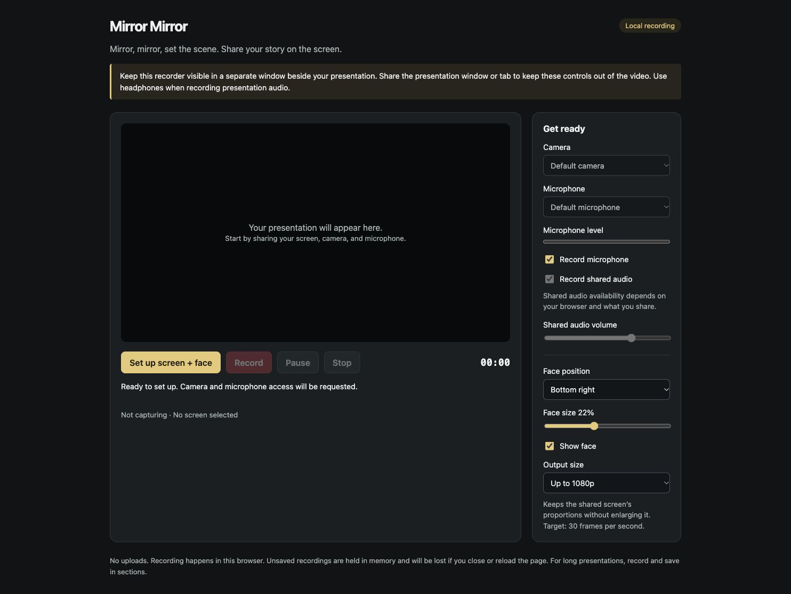

# Mirror Mirror

**Mirror, mirror, set the scene. Share your story on the screen.**

A small browser app for recording a presentation, tutorial, or demo with your screen, webcam, and voice in one video. Built by [Opendream](https://github.com/opendream). No accounts, uploads, or recording backend.



## What it does

- Combines your shared screen and webcam into one video, with four face-position presets and adjustable size.
- Mixes microphone and available shared audio into one audio track, with mute controls, a shared-audio volume slider, and a microphone level meter.
- Offers a three-second countdown, elapsed timer, pause/resume, and 720p or 1080p output limits.
- Lets you review a take with sound, save it locally, and record another take.
- Releases capture devices when you stop or cancel, and retains available video when screen sharing ends or encoding is interrupted.
- Chooses a supported recording container and gives the download the matching extension. WebM is preferred; MP4 depends on browser support. It does not transcode recordings.

## Run locally

Use **Node.js 22.12 or newer** and npm. Node 22 is used in CI; `.nvmrc` is provided for nvm users.

```sh
git clone https://github.com/opendream/mirrormirror.git
cd mirrormirror
npm ci
npm run dev
```

Open the local URL printed by Vite (normally `http://127.0.0.1:5173`). Use the development server rather than opening `index.html` as a file: the app uses JavaScript modules, and screen capture requires a secure browser context such as localhost or HTTPS.

## Record a presentation

1. Keep Mirror Mirror visible in a separate window beside your slides or demo.
2. Select **Set up screen + face**. Choose the presentation tab/window and allow camera and microphone access. Sharing the recorder itself creates a recursive preview.
3. Check your microphone level and framing. Choose your devices, face position, face size, and output size. Shared audio is available only when the browser and selected source provide it.
4. Select **Record** and wait for the countdown. Use **Pause** / **Resume** as needed.
5. Select **Stop**, play back the result with sound, and select **Save recording**. Check your browser's downloads before closing the page.
6. Select **New take** to set up again. A previous take remains available through setup, but a successfully started recording replaces it: save it first if you want to keep it.

Use headphones when recording presentation audio to reduce speaker audio being picked up again by the microphone. The screen picker may also require operating-system screen-recording permission.

## Privacy and storage

The production app processes media locally. It contains no analytics, telemetry, upload endpoint, third-party runtime scripts, or server-side recording storage. Hosting still serves normal page assets; a development server also uses Vite's development connection.

**Unsaved video lives in memory.** Reloading, closing, or crashing the page can lose it. There is no autosave or crash recovery. For long talks, record and save in sections. A leave-page warning is a convenience, not a recovery mechanism. Clicking Save requests a browser download; the app cannot confirm that you kept the downloaded file.

Personal recordings, exported media, environment files, dependencies, and generated output are ignored by Git. The Vite development server also denies access to `recordings/` and media exports. Keep personal media out of `public/`, documentation assets, and commits. Publish only the built `dist/` directory when self-hosting.

## Browser support and current limits

This is an early desktop-browser tool. Chrome has been exercised with generated screen, camera, and audio sources; that is not a guarantee for every browser, operating system, or physical device. Firefox, Safari, mobile browsers, and long sessions have not been qualified by this project.

- **Keep the recorder visible.** Browser background throttling can slow or freeze canvas video. The app warns when the page becomes hidden, but cannot guarantee background recording or detect every form of window occlusion.
- Shared tab/window/system audio availability varies by browser, OS, and selected source. `audio: true` does not guarantee a returned audio track.
- The initial setup currently requires both a camera and microphone. Hiding your face or muting audio affects the recording; it does not release that device until capture stops.
- The 30 fps setting is a target. Output preserves screen proportions, fits within the selected size limit, and does not upscale smaller sources.
- Container, codec, playback seeking, and compatibility with other video players depend on the browser's MediaRecorder implementation.
- There is no editing timeline, teleprompter, cloud storage, or built-in MP4 conversion.

Before an important talk, make a short recording on your actual hardware. For a longer rehearsal, record five minutes while changing slides and windows, check picture and sound, then make a second take without reloading.

## Development and tests

The application uses plain JavaScript modules and browser media APIs. Vite is the development/build tool; Playwright is used only for browser testing. There is no UI framework or production JavaScript dependency.

```sh
npm test                       # Node unit tests
npm run check                  # Syntax/control checks, unit tests, production build
npx playwright install chromium
npm run test:browser            # Generated-media browser integration checks
```

On a Linux CI runner, use `npx playwright install --with-deps chromium`. To inspect the same browser suite manually, start `npm run dev` and open `/tests/browser-smoke.html`, then select **Run synthetic recording tests**. These tests generate canvas video and audio tones; they do not request your camera, microphone, or screen permissions.

The browser suite checks encoded motion and face composition, both audio sources in playback, pause timing, repeat takes, source cleanup, missing shared audio, permission rejection, countdown cancellation, device switching, and error recovery. It does not replace the physical-device rehearsal above. The CI workflow runs the checks on pushes and pull requests.

## Project layout

```text
index.html                 Accessible controls and page structure
src/
  main.js                  Application entry point
  app.js                   Recording flow and UI coordination
  capture.js               Screen/camera/microphone ownership and readiness
  audio.js                 Audio mixing and microphone metering
  compositor.js            Screen + face canvas rendering
  recording.js             MediaRecorder and encoded chunk lifecycle
  geometry.js              Output sizing and overlay placement
  format.js                Formats, filenames, and recording clock
  ui.js                    Control states, settings, and device options
  errors.js                User-facing capture errors
  styles.css               Responsive layout and styling
scripts/                   Validation and browser-test runner
tests/                     Unit tests and generated-media browser harness
```

`mirror-mirror.html` is a compatibility link to the homepage for older local bookmarks.

## Build and self-host

```sh
npm run build
npm run preview
```

The build writes static assets to `dist/`, which can be served from an HTTPS static host. The relative asset base supports deployment beneath a URL prefix. `npm run preview` is a local build preview, not a production server. This repository does not configure a hosted demo or GitHub Pages deployment.

## Contributing

Bug reports, documentation improvements, and focused pull requests are welcome. Read [CONTRIBUTING.md](CONTRIBUTING.md) for setup, test expectations, and the manual recording checklist. Avoid attaching personal recordings or private screen contents to public issues.

## License

[MIT](LICENSE). Copyright © 2026 Opendream and contributors.
